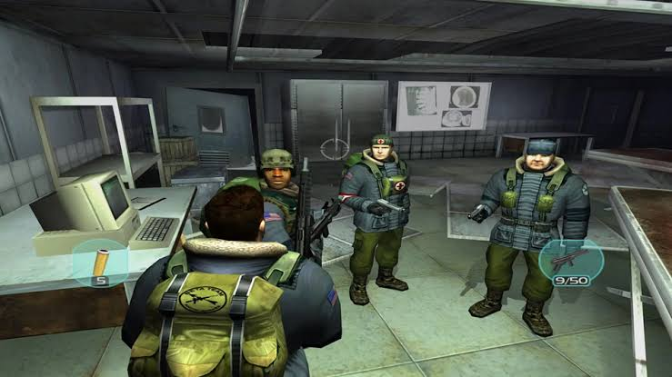
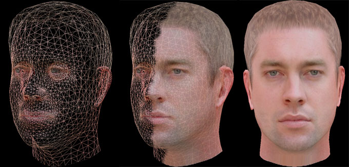
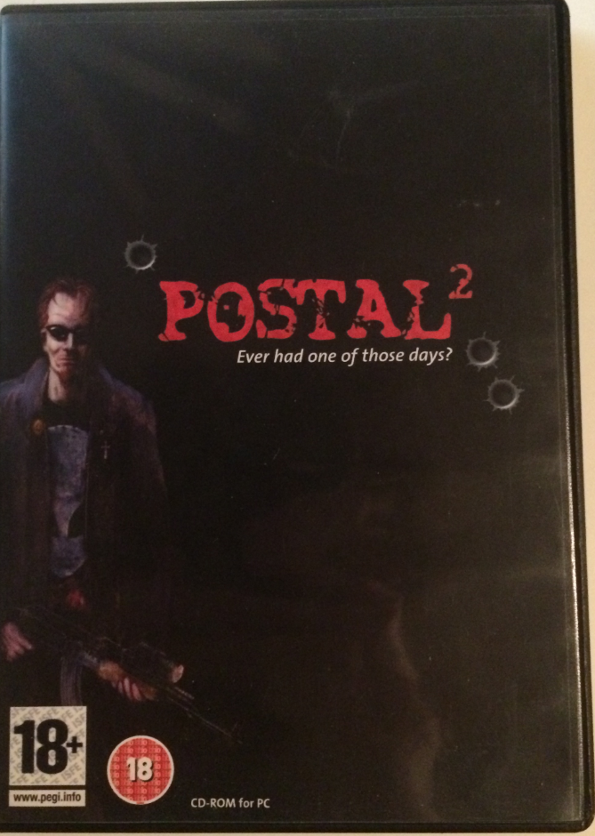
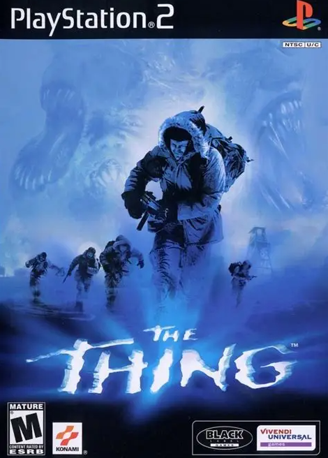

a# postal2-half-dude-the-thing
## Postal 2: Half Dude - The Thing Remake
A total conversion mod for Postal 2 that fuses the free-roam sandbox chaos of Postal 2 with the unscripted paranoia and survival horror of *The Thing* (2002) and the atmosphere of Half-Life 2's Ravenholm.


## Github Treeview
[https://treegit.macosxjs.com/?url=igiteam/postal2-half-dude-the-thing
](https://treegit.macosxjs.com/?url=igiteam/postal2-half-dude-the-thing)

## Github Tree Api Direct JSON
[https://api.github.com/repos/igiteam/postal2-half-dude-the-thing/git/trees/main?recursive=1
](https://api.github.com/repos/igiteam/postal2-half-dude-the-thing/git/trees/main?recursive=1)

## Postal2 Webassembly
[https://kahnstation.kahn.lol/gopostal/](https://kahnstation.kahn.lol/gopostal/)

## Postal2 Half Dude mod - the base of the gameplay
[](https://www.youtube.com/watch?v=0WzzNyDDbVI)

[](https://archive.org/details/thing-pc-redump)

[](https://ytembed.macosxjs.com/?WHJtSG5jRC16LVE)

[](https://ytembed.macosxjs.com/?MXN4V1ZVNWZmS28)


## WS11WineCX20.0.4 (MacOSX Big Sur 32bit)
[WS11WineCX20.0.4.tar.7z](https://github.com/vitor251093/porting-kit-engines/releases/download/wineskin/WS11WineCX20.0.4.tar.7z)

[](https://github.com/igiteam/wine_engines)

## Digimask
[](https://archive.org/details/digimask-launchpad2-2002)

[DigimaskPS2.txt](https://raw.githubusercontent.com/igiteam/postal2-half-dude-the-thing/refs/heads/main/digimaskps2.txt)

[This is Football 2005 PS2 Digimask](https://archive.org/download/PS2_COLLECTION_PART25/This%20Is%20Football%202005%20%28Europe%29%20%28En%2CEs%2CPt%2CAr%29.zip)


## Concept

This is not a linear horror game. It is a **paranoia sandbox**. The player is dropped into a sprawling, snowed-in environment (based on The Thing's Antarctic outpost) with a squad of NPCs who have their own lives, schedules, and secrets.

Nobody knows who is infected. There are no cutscenes that reveal the monster. The horror is emergent, created by the simulation itself. You recruit people. You blood-test them. You watch them break down under fear. And sometimes, you're too late.

### Reference Links
- [https://archive.org/details/postal2_202004](https://archive.org/details/postal2_202004)
- [https://archive.org/details/thing-pc-redump](https://archive.org/details/thing-pc-redump)
- [https://github.com/kizoky/p2unrealscript](https://github.com/kizoky/p2unrealscript)
- [https://github.com/igiteam/postal2-half-dude-the-thing/blob/main/DNF2001_FORMATS.md](https://github.com/igiteam/postal2-half-dude-the-thing/blob/main/DNF2001_FORMATS.md)
- [https://github.com/SuiMachine/The-Thing-Wrapper](https://github.com/SuiMachine/The-Thing-Wrapper)
- [https://archive.org/details/unreal-script-classes](https://archive.org/details/unreal-script-classes)
- [https://archive.org/details/forums.epicgames.com](https://archive.org/details/forums.epicgames.com)
- [https://archive.org/details/DukeNukemForver2001LeakedBuild](https://archive.org/details/DukeNukemForver2001LeakedBuild)
- [https://www.moddb.com/downloads/start/255975?referer=https%3A%2F%2Fwww.moddb.com%2Fmods%2Fdnf2001-restoration-project](https://www.moddb.com/downloads/start/255975?referer=https%3A%2F%2Fwww.moddb.com%2Fmods%2Fdnf2001-restoration-project)
- [https://steamcommunity.com/sharedfiles/filedetails/?id=558183480](https://steamcommunity.com/sharedfiles/filedetails/?id=558183480)
- [https://www.moddb.com/mods/chrzans-widescreen-fix-for-stp-and-aw/downloads/widescreen-fixes-source](https://www.moddb.com/mods/chrzans-widescreen-fix-for-stp-and-aw/downloads/widescreen-fixes-source)
- [https://github.com/Jeffsteelflex/nightfire-port](https://github.com/Jeffsteelflex/nightfire-port)
- [http://fallout.bplaced.net/gameserver/mohpa/files/mohpa_mdk/ai_and_scripting/class_reference.html](http://fallout.bplaced.net/gameserver/mohpa/files/mohpa_mdk/ai_and_scripting/class_reference.html)
- [https://www.moddb.com/games/postal-2/tutorials](https://www.moddb.com/games/postal-2/tutorials)
- [https://beyondunrealwiki.github.io/pages/unrealscript-lessons.html](https://beyondunrealwiki.github.io/pages/unrealscript-lessons.html)
- [https://github.com/BeyondUnrealWiki/BeyondUnrealWiki.github.io](https://github.com/BeyondUnrealWiki/BeyondUnrealWiki.github.io)
- [https://steamcommunity.com/sharedfiles/filedetails/?id=259272369](https://steamcommunity.com/sharedfiles/filedetails/?id=259272369)
- [https://steamcommunity.com/sharedfiles/filedetails/?id=257870337](https://steamcommunity.com/sharedfiles/filedetails/?id=257870337)
- [https://steamcommunity.com/sharedfiles/filedetails/?id=627130941](https://steamcommunity.com/sharedfiles/filedetails/?id=627130941)
- [https://steamcommunity.com/sharedfiles/filedetails/?id=1358868268](https://steamcommunity.com/sharedfiles/filedetails/?id=1358868268)
- [https://steamcommunity.com/sharedfiles/filedetails/?id=545318800](https://steamcommunity.com/sharedfiles/filedetails/?id=545318800)
- [https://steamcommunity.com/sharedfiles/filedetails/?id=472643736](https://steamcommunity.com/sharedfiles/filedetails/?id=472643736)
- [https://steamcommunity.com/sharedfiles/filedetails/?id=737631813](https://steamcommunity.com/sharedfiles/filedetails/?id=737631813)
- [https://steamcommunity.com/sharedfiles/filedetails/?id=738015266](https://steamcommunity.com/sharedfiles/filedetails/?id=738015266)
- [https://steamcommunity.com/sharedfiles/filedetails/?id=768635358](https://steamcommunity.com/sharedfiles/filedetails/?id=768635358)
- [https://steamcommunity.com/sharedfiles/filedetails/?id=791667661](https://steamcommunity.com/sharedfiles/filedetails/?id=791667661)
- [https://steamcommunity.com/sharedfiles/filedetails/?id=3334953346](https://steamcommunity.com/sharedfiles/filedetails/?id=3334953346)
- [https://steamcommunity.com/sharedfiles/filedetails/?id=2046034789](https://steamcommunity.com/sharedfiles/filedetails/?id=2046034789)
- [https://steamcommunity.com/sharedfiles/filedetails/?id=2065382489](https://steamcommunity.com/sharedfiles/filedetails/?id=2065382489)
- [https://steamcommunity.com/sharedfiles/filedetails/?id=2120417616](https://steamcommunity.com/sharedfiles/filedetails/?id=2120417616)
- [https://steamcommunity.com/sharedfiles/filedetails/?id=3424785863](https://steamcommunity.com/sharedfiles/filedetails/?id=3424785863)
- [https://steamcommunity.com/sharedfiles/filedetails/?id=3624720973](https://steamcommunity.com/sharedfiles/filedetails/?id=3624720973)
- [https://steamcommunity.com/sharedfiles/filedetails/?id=3689128517](https://steamcommunity.com/sharedfiles/filedetails/?id=3689128517)
- [https://steamcommunity.com/sharedfiles/filedetails/?id=3774314243](https://steamcommunity.com/sharedfiles/filedetails/?id=3774314243)
- [http://fallout.bplaced.net/gameserver/mohpa/files/mohpa_mdk/ai_and_scripting/ai_and_scripting_topics.htm](http://fallout.bplaced.net/gameserver/mohpa/files/mohpa_mdk/ai_and_scripting/ai_and_scripting_topics.htm)
- [https://treegit.macosxjs.com/?url=https://github.com/Jeffsteelflex/nightfire-port](https://treegit.macosxjs.com/?url=https://github.com/Jeffsteelflex/nightfire-port)
- [https://treegit.macosxjs.com/?url=https://github.com/kizoky/p2unrealscript](https://treegit.macosxjs.com/?url=https://github.com/kizoky/p2unrealscript)
- [https://www.moddb.com/games/brothers-in-arms-earned-in-blood/downloads/bia-eib-sdk-new](https://www.moddb.com/games/brothers-in-arms-earned-in-blood/downloads/bia-eib-sdk-new)
- [https://www.gildor.org/smf/index.php?topic=8889.0](https://www.gildor.org/smf/index.php?topic=8889.0)
- [Brothers In Arms road to Hill 30: How to get Unreal Editor to Work](https://ytembed.macosxjs.com/?cDlKekVueng4Y2c)
- [https://sites.google.com/site/biawarzone/downloads](https://sites.google.com/site/biawarzone/downloads)
- [https://www.youtube.com/playlist?list=PLfmWj_TzuPMDRi7LAHfUbbpl1hL3gx9oq](https://www.youtube.com/playlist?list=PLfmWj_TzuPMDRi7LAHfUbbpl1hL3gx9oq)
- [Map Making #7 - Brothers in Arms: Earned in Blood Mod - MOWAS2](https://www.youtube.com/watch?v=ZXP1RCMCu10)

## The Ultimate POSTAL 2 Mods Installation Guide
[](https://www.youtube.com/watch?v=MMkF9aJnUSk&t=7s)

## Postal 2 video tutorials
[](https://www.youtube.com/playlist?list=PLzlHQaNpSPoVHU1drEgjgEsZmX9DkNbBx)

[](https://www.youtube.com/playlist?list=PLb8oNKiUbnjH9MZYeI3zRvRXYDSMJkSSZ)

## The Thing Editor & Modding
[](https://www.moddb.com/games/the-thing/downloads/editor-files-password-viruspunk)

## How to Mod The Thing with Editor
[How to Mod The Thing with Editor](https://www.moddb.com/games/the-thing/tutorials/how-to-mod-the-thing-with-editor)

## AudioScriptTM The Thing
[https://audioscripttm.macosxjs.com/](https://audioscripttm.macosxjs.com/)

[https://thethingscript.macosxjs.com/](https://thethingscript.macosxjs.com/)

## The Thing 1982 OST
- [https://archive.org/details/the-thing-original-motion-picture-soundtrack?webamp=default](https://archive.org/details/the-thing-original-motion-picture-soundtrack?webamp=default)
[](https://www.youtube.com/watch?v=kXBGDf2IDQI&list=RDkXBGDf2IDQI)

## The Thing 1982 
- [https://archive.org/details/the-thing-original-motion-picture-soundtrack?webamp=default](https://archive.org/details/the-thing-original-motion-picture-soundtrack?webamp=default)
- [https://dn710209.ca.archive.org/0/items/the.-thing.-1982.1080p.-blu-ray.x-264-yts.-ag_202409/The.Thing.1982.1080p.BluRay.x264-%5BYTS.AG%5D.mp4](https://dn710209.ca.archive.org/0/items/the.-thing.-1982.1080p.-blu-ray.x-264-yts.-ag_202409/The.Thing.1982.1080p.BluRay.x264-%5BYTS.AG%5D.mp4)


## Core Pillars

### 1. Free-Roam Paranoia
- **Living NPCs**: Postal 2's native AI gives every NPC a schedule and a personality. They wander, they talk, they react.
- **Unscripted Infection**: 25% of NPCs are secretly infected. The infection timer is random. You never know when someone will turn.
- **No Scripted Scares**: The game does not tell you when someone is a Thing. You have to figure it out.

### 2. The Squad System (HL2 Inspired)
- **Recruitment**: You can ask NPCs to join your squad. If their `TrustLevel` is high enough, they follow you.
- **Shared Risk**: Every squad member is a potential threat. Do you bring your most trusted ally into the dark basement, or leave them upstairs with the others?
- **Squad Tactics**: NPCs use morale-based tactics (advance, fallback, flank, charge) inspired by *Medal of Honor: Pacific Assault*.

### 3. The Psychology Engine (The Thing Inspired)
- **TrustLevel (0-100)**: Increases when you heal them or pass a blood test. Decreases when you point a gun at them or kill a human.
- **FearLevel (0-100)**: Spikes when they see a monster or a corpse. Decays slowly over time.
- **ParanoiaLevel (0-100)**: Rises when you hold a weapon nearby. Makes NPCs jumpy and unpredictable.
- **MoraleLevel (0-19)**: A *MoHPA*-inspired combat stress meter. Low morale = panic. High morale = confidence.

### 4. The Blood Test
- The player's only tool for revealing the truth.
- Trace forward, use the test, and wait for the result.
- If the NPC is human: Trust increases, Fear decreases.
- If the NPC is a Thing: It transforms immediately and attacks.
- **Limited Uses**: You can't test everyone. You have to make choices.

### 5. The Thing Monster
- When an NPC's infection timer hits zero, they transform.
- The `ThingMonster` is a relentless melee hunter with high health and brutal damage.
- It screams when it spawns. It roars when it's hurt. It does not stop.

### 6. The Suicide System (Call of Cthulhu Inspired)
- If an NPC's `FearLevel` stays above 85 for more than 5 seconds, they snap.
- They play a scream, a gunshot, and then they kill themselves.
- Witnessing a suicide broadcasts fear to all nearby NPCs, potentially causing a chain reaction.
- **Visual Effects**: Screen blood overlays (via `ThingHUD`) and camera shakes make the moment visceral.

### 7. The Weapon Feel (Nightfire PS2 Inspired)
- **Sway**: The gun bobs as you walk, using the exact sine-wave math from Nightfire PS2.
- **Recoil**: A snappy kick that decays by 25% per frame.
- **ADS (Aim Down Sights)**: A smooth 10-frame transition to iron sights, using the exact smoothstep formula from Nightfire PS2.
- **Dead-Zone Free Aim**: The gun moves within a dead zone before the camera turns, giving the "Wii-style" feel.

### 8. The Fire System (Postal 2 Native)
- Postal 2's fire propagation is excellent for a *Thing* game.
- Fire spreads. NPCs catch fire. Things burn.
- The flamethrower is not just a weapon—it's a tool for survival. But fire is unpredictable. It can spread to your own shelter.

### 9. Facial Animation (WIP)
- **Goal**: Use extracted DigiMask textures from The Thing PS2 to create varied facial expressions.
- **Technique**: UV-scrolling texture layers (Max Payne / SWAT 3 style) with masks.
- **Fallback**: Pre-baked `MaterialSequence` swaps or bone-based eye/jaw animation.

## Technical Foundation

### Engine
- **Unreal Engine 2** (Postal 2's modified engine).
- **Editor**: POSTed (Postal 2 Editor).

### Core UnrealScript Classes
| Class | Purpose |
|-------|---------|
| `ThingGameInfo.uc` | Injects custom AI into Postal 2's maps. |
| `ThingSquadController.uc` | The AI brain (Trust, Fear, Paranoia, Infection). |
| `ThingRecruitTrigger.uc` | The interaction for recruiting NPCs. |
| `ThingBloodTest.uc` | The blood test item. |
| `ThingMonster.uc` | The creature body (health, attacks, animations). |
| `ThingMonsterController.uc` | The hunting AI. |
| `ThingWeapon.uc` | The Nightfire-style weapon feel (sway, recoil, ADS). |
| `TheThingSuicideSystem.uc` | The sanity/suicide manager. |
| `ThingHUD.uc` | The paranoia HUD (trust/fear bars, screen effects). |

## Postal 2 Test Maps

- Thing_Test_Wind.fuk
- Thing_Test_Wind_Physics.fuk
- Thing_Test_Fire.fuk
- Thing_Test_Fire_Propagation.fuk
- Thing_Test_Fire_Wind_Interaction.fuk
- Thing_Test_NPC_Human.fuk
- Thing_Test_NPC_Monster.fuk
- Thing_Test_NPC_Fire_Interaction.fuk
- Thing_Test_Smoke.fuk
- Thing_Test_Debris.fuk
- Thing_Test_Karma_Physics.fuk
- Thing_Test_Environmental_Effects.fuk
- Thing_Test_Combined_Systems.fuk
- Thing_Test_Performance.fuk
- Thing_Test_Stress.fuk
- Thing_Test_Debug.fuk
- Thing_Test_Temperature.fuk
- Thing_Test_Heating.fuk
- Thing_Test_Cold_Exposure.fuk
- Thing_Test_Hypothermia.fuk
- Thing_Test_Frozen_Objects.fuk
- Thing_Test_Defrosting.fuk
- Thing_Test_Weather.fuk
- Thing_Test_Wind_Chill.fuk
- Thing_Test_Engine_Heating.fuk
- Thing_Test_Generator_Heating.fuk
- Thing_Test_Radiator_Heating.fuk
- Thing_Test_Local_Temperature_Zones.fuk
- Thing_Test_Environmental_Survival.fuk
- Thing_Test_Combined_Thermal_Systems.fuk
- Thing_Test_Thermal_Performance.fuk
- Thing_Test_Thermal_Stress.fuk

## Squad System
1. [https://raw.githubusercontent.com/igiteam/postal2-half-dude-the-thing/main/ThingSquad.uc](https://raw.githubusercontent.com/igiteam/postal2-half-dude-the-thing/main/ThingSquad.uc)
2. [https://raw.githubusercontent.com/igiteam/postal2-half-dude-the-thing/main/ThingSquadController.uc](https://raw.githubusercontent.com/igiteam/postal2-half-dude-the-thing/main/ThingSquadController.uc)
3. [https://raw.githubusercontent.com/igiteam/postal2-half-dude-the-thing/main/ThingSquadRecruitment.uc](https://raw.githubusercontent.com/igiteam/postal2-half-dude-the-thing/main/ThingSquadRecruitment.uc)
4. [https://raw.githubusercontent.com/igiteam/postal2-half-dude-the-thing/main/ThingSquadHud.uc](https://raw.githubusercontent.com/igiteam/postal2-half-dude-the-thing/main/ThingSquadHud.uc)
5. [https://raw.githubusercontent.com/igiteam/postal2-half-dude-the-thing/main/ThingRecruitTrigger.uc](https://raw.githubusercontent.com/igiteam/postal2-half-dude-the-thing/main/ThingRecruitTrigger.uc)
6. [https://raw.githubusercontent.com/igiteam/postal2-half-dude-the-thing/main/ThingSquadWorkInProgress.md](https://raw.githubusercontent.com/igiteam/postal2-half-dude-the-thing/main/ThingSquadWorkInProgress.md)
7. [https://raw.githubusercontent.com/igiteam/postal2-half-dude-the-thing/main/ThingSquad.md](https://raw.githubusercontent.com/igiteam/postal2-half-dude-the-thing/main/ThingSquad.md)
8. [https://raw.githubusercontent.com/igiteam/postal2-half-dude-the-thing/main/ThingSquadController.md](https://raw.githubusercontent.com/igiteam/postal2-half-dude-the-thing/main/ThingSquadController.md)
9. [https://raw.githubusercontent.com/igiteam/postal2-half-dude-the-thing/main/ThingSquadAudio.md](https://raw.githubusercontent.com/igiteam/postal2-half-dude-the-thing/main/ThingSquadAudio.md)
10. [https://raw.githubusercontent.com/igiteam/postal2-half-dude-the-thing/main/ThingSquadAudio.uc](https://raw.githubusercontent.com/igiteam/postal2-half-dude-the-thing/main/ThingSquadAudio.uc)

## Flame system
[https://github.com/igiteam/postal2-half-dude-the-thing/blob/main/ThingFireGrid.uc](https://github.com/igiteam/postal2-half-dude-the-thing/blob/main/ThingFireGrid.uc)
[https://github.com/igiteam/postal2-half-dude-the-thing/blob/main/ThingFirePropagation.md](https://github.com/igiteam/postal2-half-dude-the-thing/blob/main/ThingFirePropagation.md)
[https://github.com/igiteam/postal2-half-dude-the-thing/blob/main/ThingFlamethrower.md](https://github.com/igiteam/postal2-half-dude-the-thing/blob/main/ThingFlamethrower.md)
[https://github.com/igiteam/postal2-half-dude-the-thing/blob/main/ThingFlameChunk.uc](https://github.com/igiteam/postal2-half-dude-the-thing/blob/main/ThingFlameChunk.uc)
[https://github.com/igiteam/postal2-half-dude-the-thing/blob/main/cg_flamethrower.c](https://github.com/igiteam/postal2-half-dude-the-thing/blob/main/cg_flamethrower.c)

# **Initial Architectural Findings**

- `ThingSquad.uc` owns the central roster, player owner, shared enemy and current order.
- `ThingSquadController.uc` retains individual NPC psychology and combat AI.
- `ThingSquadRecruitment.uc` currently has its own separate member array.
- `ThingRecruitTrigger.uc` provides proximity-based recruitment interaction.
- `ThingSquadHud.uc` displays squad status.
- `ThingSquadAudio.uc` provides structured action/reaction voice selection.

There is already a potential architectural conflict: both `ThingSquad` and `ThingSquadRecruitment` maintain squad membership. We should resolve that before expanding the system.

## **1. Critical Issues I Found**

These are the things I'd fix before adding more features.

### **A. Recruitment Has Two Competing Rosters**

**Priority: Critical**

`ThingSquad.uc` uses `Members`, whereas `ThingSquadRecruitment.uc` uses `RecruitedMembers`.

Recruitment currently adds NPCs to its own array instead of calling `ThingSquad.AddMember()`.

**Fix:** `ThingSquad` must be the single authority for membership.

### **B. Controller Variables Are Inconsistent**

**Priority: Critical**

The recruitment file references:

- `bIsRecruited`
- `SquadCommander`

These are not declared in the current controller source.

The HUD also references:

- `SquadID`
- `bIsSquadLeader`
- `bIsInSquad`
- `SquadRole`

These are not declared in the current controller either.

**Fix:** Establish one consistent membership and ownership model.

### **C. Recruitment Trigger Calls a Missing Function**

**Priority: Critical**

`ThingRecruitTrigger.uc` calls:

```
TargetController.TryRecruit(PlayerPawn)
```

There is no `TryRecruit()` implementation in the controller shown.

**Fix:** Route the interaction through `ThingSquadRecruitment`, which then calls the central squad manager.

### **D. Following Isn't Implemented**

**Priority: High**

`ThingSquadController.UpdateSquadTactics()` currently returns immediately when `SquadLeader == None`.

That is incompatible with a player-led squad unless we change the controller's logic.

**Fix:** Implement player-follow behaviour independently of an NPC squad leader.

### **E. HUD Uses a Different Squad Architecture**

**Priority: High**

`ThingSquadHud` searches all controllers by `SquadID` and leader flags rather than reading the central `ThingSquad.Members` roster.

**Fix:** Make the HUD read directly from the authoritative squad manager.

These issues are visible in the current source implementations. (GitHub +4)

## **2. What Is Already Good**

There is quite a bit worth preserving.

| System                       | Assessment          |
| ---------------------------- | ------------------- |
| Central squad manager        | Good foundation     |
| Dynamic member array         | Good                |
| Trust-based recruitment      | Good                |
| Shared enemy variable        | Good starting point |
| Tactical orders              | Good starting point |
| Infection and transformation | Preserve            |
| Morale and psychology        | Preserve            |
| HUD rendering                | Useful prototype    |
| Voice record structure       | Promising           |
| NPC recruitment interaction  | Needs integration   |

In particular, I like that `ThingSquad.uc` explicitly allows infected NPCs to be recruited.

That's an excellent design decision for a paranoia horror game: you might recruit someone who is already infected without knowing it. (GitHub +1)

## **3. The Architecture I Recommend Now**

I'd consolidate the project around this structure:

```
ThingSquad.uc
│
├── Authoritative roster
├── Player ownership
├── Tactical orders
├── Enemy knowledge
└── Squad capacity
│
├── Recruitment
│   └── ThingSquadRecruitment
│
├── Interaction
│   └── ThingRecruitTrigger
│
├── NPC Intelligence
│   └── ThingSquadController
│
├── Presentation
│   └── ThingSquadHud
│
└── Communication
    └── ThingSquadAudio
```

The player owns the squad. NPC controllers remain responsible for their own personalities and behaviour.

## **4. My Recommended Development Roadmap**

I'd work in this order:

1. **Unify membership:** Connect recruitment to `ThingSquad.AddMember()` and `RemoveMember()`.
2. **Fix controller integration:** Add the missing membership references and ensure the controller can follow the player.
3. **Fix recruitment interaction:** Make the trigger recruit the NPC the player is actually looking at.
4. **Fix the HUD:** Display the central squad roster.
5. **Implement shared enemy awareness:** Recruits inherit the squad's known enemy.
6. **Implement formations:** Followers spread out instead of walking into each other.
7. **Implement tactical orders:** Follow, hold, advance, fallback, flank and charge.
8. **Integrate audio:** Connect `ThingSquadAudio` to actual NPC events.
9. **Add personality-driven squad behaviour:** Fear, paranoia, trust, morale and infection influence decisions.

**Recommended next step:** Fix the duplicate squad rosters first. Everything else should build on `ThingSquad` as the single source of truth for squad membership.

# **What We Should Take from The Thing (2002)**

## **1. NPC Roles**

The original game had three principal NPC classes:

- **Soldiers:** Better combat performance and more health.
- **Medics:** Heal the player and other squad members.
- **Engineers:** Repair electrical systems and unlock progression.

This is something I'd absolutely bring into your Postal 2 mod.

We could have different NPC professions, each with useful abilities outside combat.

## **2. Trust and Fear Must Be Separate**

The original system had an important distinction:

| Attribute | Gameplay effect                                 |
| --------- | ----------------------------------------------- |
| Trust     | Determines whether NPCs obey you                |
| Fear      | Determines how NPCs react to danger             |
| Morale    | Determines combat confidence                    |
| Infection | Determines whether an NPC eventually transforms |

Your existing Paranoia Engine already has these separate attributes. That's a very good foundation.

## **3. NPCs Must Be Useful in Combat**

One of the review's biggest compliments was that squadmates could genuinely defend the player.

I'd implement:

- Autonomous target selection.
- Covering fire.
- Ammunition awareness.
- Medic healing.
- Friendly-fire avoidance.
- Retreating when overwhelmed.
- Tactical positioning.

## **4. Infection Must Be Genuinely Unpredictable**

**Important design decision**

This is probably the biggest lesson from the original game.

The original developers wanted randomized infection, but narrative requirements forced particular characters to transform at predetermined moments. The developers themselves discussed this conflict.

For your mod, I'd do something different:

- NPC infection is determined independently.
- Enemy contact can cause infection probabilistically.
- Infection has a hidden incubation timer.
- Blood tests reveal the actual infection state.
- A confirmed human must never arbitrarily transform because a scripted event demands it.
- NPCs can transform even when the player isn't watching.

That last point is particularly important for your paranoia sandbox.

## **5. My Proposed Squad Features**

| Feature                  | Inspiration                     |
| ------------------------ | ------------------------------- |
| Dynamic recruitment      | Half-Life 2                     |
| Fear and trust           | The Thing                       |
| NPC professions          | The Thing                       |
| Tactical combat          | Medal of Honor: Pacific Assault |
| Squad coordination       | Half-Life 2                     |
| Individual personalities | Your Paranoia Engine            |
| Infection simulation     | The Thing, redesigned           |
| Autonomous survival      | Your own system                 |

## **6. One Thing I Would Change from the Original Game**

**Don't make squadmates disposable.**

In The Thing, companions often disappear between sections, which makes it difficult to become attached to them.

Your Postal 2 sandbox could make NPC relationships much more meaningful:

- Recruits remember previous missions.
- NPCs develop relationships with other squad members.
- They remember being rescued.
- They can refuse orders if trust is low.
- They can become frightened of another squad member.
- They can abandon the player after repeated mistreatment.
- They can secretly be infected.

That creates emergent storytelling rather than relying on scripted events.

## **My Conclusion**

I'd use three games as the primary design references:

- **Half-Life 2:** Squad architecture, recruitment and coordination.
- **The Thing (2002):** Psychology, fear, trust and infection.
- **Medal of Honor: Pacific Assault:** Tactical combat and battlefield squad behaviour.

The objective should be to combine these influences into something more ambitious: a persistent, autonomous squad where every NPC has a profession, personality, psychological state, relationships and potentially a hidden infection.

**The player shouldn't simply command a squad. They should have to manage a group of people who have their own fears, motivations and survival instincts.**

##  Karma Physics Engine
[https://beyondunrealwiki.github.io/pages/karma.html](https://beyondunrealwiki.github.io/pages/karma.html)

[https://unrealarchive.org/wikis/unreal-wiki/Legacy:PhysicsType.html](https://unrealarchive.org/wikis/unreal-wiki/Legacy:PhysicsType.html)

[https://beyondunrealwiki.github.io/pages/karma-functions-and-events.html](https://beyondunrealwiki.github.io/pages/karma-functions-and-events.html)

# How to Add Data in Postal 2

## File Extensions

| Extension | Directory |
|---|---|
| `.UKX` | Animations |
| `.KA` | KarmaData |
| `.FUK` | Maps |
| `.OGG` | Music |
| `.UAX` | Sounds |
| `.USX` | StaticMeshes |
| `.U`, `.INT` | System (or Scripts in Custom Directory) |
| `.INI` | System (in main game) |
| `.UTX` | Textures |

## How to Add Data in Postal 2

Create a `custom_mod_folder` and add the following directories:

- Animations
- KarmaData
- Maps
- Music
- Sounds
- StaticMeshes
- Textures

Move or copy all files into their respective folders:

| File Extension | Destination Folder |
|---|---|
| `.UKX` | Animations |
| `.KA` | KarmaData |
| `.FUK` | Maps |
| `.OGG` | Music |
| `.UAX` | Sounds |
| `.USX` | StaticMeshes |
| `.U`, `.INT`, `.INI` | System |
| `.UTX` | Textures |

## How to Install the Mod

1. Create a copy of `Postal2.ini`.
2. Rename the copied file to `Default.ini`.
3. Edit `Default.ini`.
4. Modify the `Paths` entries to include the custom mod directories:

```ini
Paths=..\..\System\*.u
Paths=..\..\Animations\*.ukx
Paths=..\..\KarmaData\*.ka
Paths=..\..\Maps\*.fuk
Paths=..\..\Music\*.ogg
Paths=..\..\Sounds\*.uax
Paths=..\..\StaticMeshes\*.usx
Paths=..\..\Textures\*.utx
```

### Asset Pipeline
1. **Models**: Extract from PS2 ISO → Blender → `.psk` / `.psa` → POSTed.
2. **Textures**: Extract → `.dds` / `.tga` → `.utx` → POSTed.
3. **Sounds**: Extract → `.wav` (22050 Hz, 16-bit, mono) → `.uax` → POSTed.
4. **Maps**: Rebuild manually in POSTed (no converter from PS2 format).


## Current Status

- ✅ Design document finalized.
- ✅ Core UnrealScript classes drafted.
- ✅ Asset extraction pipeline identified.
- 🚧 Injection test (first playable prototype) in progress.
- 🚧 Map design (Antarctic outpost) not started.
- 🚧 Facial animation system under research.


[](https://raw.githubusercontent.com/igiteam/postal2-half-dude-the-thing/main/postal2-pc-cover.png) 

[](https://raw.githubusercontent.com/igiteam/postal2-half-dude-the-thing/main/the-thing-2002-ps2-cover.png)

## Unreal Engine Game List
[](https://unrealenginegames.netlify.app/)
## Unreal Tournament 2004 Archive
[](https://unrealarchive.org/unreal-tournament-2004/index.html)

## How to Contribute
1. Clone the repository.
2. Install Postal 2 (version 1409 recommended).
3. Set up POSTed and the UnrealScript compiler (`ucc.exe`).
4. Pick a task from the "Current Status" list.
5. Submit a pull request with your changes.

## Dev Environment

**Official White Wii Remote With Nunchuk — Tested And Working — £14.99**
[https://www.ebay.co.uk/itm/800847189353](https://www.ebay.co.uk/itm/800847189353)

**Infrared Sensor Bar USB for Wii Emulator Remote Motion Detection Setup — £6.69**
[https://www.ebay.co.uk/itm/227423830875](https://www.ebay.co.uk/itm/227423830875)

**Apple MacBook Pro Retina 15in (2014) i7 2.8GHz 16GB 1TB SSD GT 750M — £120.30**
[https://www.ebay.co.uk/itm/800844561513](https://www.ebay.co.uk/itm/800844561513)

**WS11WineCX20.0.4 (Wine engine)**
[https://igiteam.github.io/wine_engines/](https://igiteam.github.io/wine_engines/)

**Official Genuine Sony PS3 PlayStation 3 DualShock 3 Wireless Controller Black — £19.99**
[https://www.ebay.co.uk/itm/840031043465](https://www.ebay.co.uk/itm/840031043465)

**Amazon Basics 4K HDMI Cable 3m — 18Gbps High Speed with Ethernet, 4K@60Hz, 2160p — £8.44**
[https://www.ebay.co.uk/itm/327352257557](https://www.ebay.co.uk/itm/327352257557)

**wiimote_nunchuk_macosx**
[https://github.com/igiteam/wiimote-nunchuk](https://github.com/igiteam/wiimote-nunchuk)

**xbox360_input_gui_py**
[https://github.com/igiteam/xbox360_input_gui_py](https://github.com/igiteam/xbox360_input_gui_py)

**logitec_mx_mouse_3_macos**
[https://github.com/igiteam/logitec_mx_mouse_3_macos](https://github.com/igiteam/logitec_mx_mouse_3_macos)

**igi1-macbook-3d-workstation**
[https://github.com/igiteam/igi1-macbook-3d-workstation](https://github.com/igiteam/igi1-macbook-3d-workstation)

---
